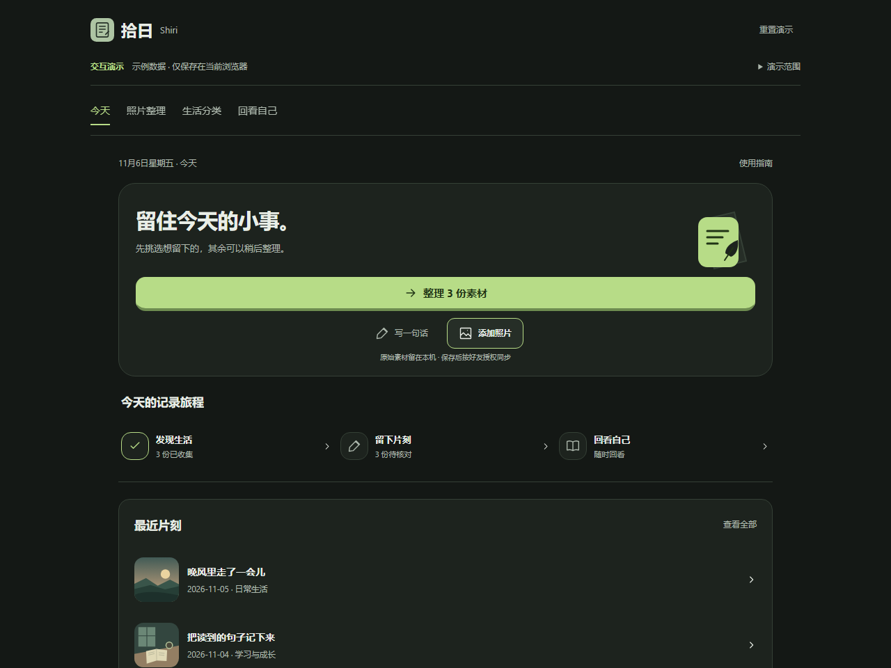

# Shiri · 拾日

**Keep your moments. Look back on your life. Stay close to the people who matter.**

[简体中文](README.md) · [Setup](docs/SETUP.md) · [Contributing](CONTRIBUTING.md)

Shiri is an early-stage personal life journal built with HTML, CSS, JavaScript and Capacitor. Review photos, save meaningful moments, and revisit them through a calendar, daily feelings and evidence-based rule summaries. Close friends can view moments within the access scope you explicitly grant.

## Try locally

Use Node.js 24 LTS. In the source directory run the following commands.

~~~bash
npm ci --ignore-scripts --no-audit --no-fund
npm run demo
~~~

Open http://127.0.0.1:4188/ . The demo reuses real UI and review/report logic with synthetic records and original illustrative assets. Its isolated browser store never reads your production diary or login session. Cloud authentication, device gallery, friends and AI are outside the demo. No model downloads or cloud setup are needed.

[Browser recording](docs/images/demo.webm) · [Static demo deployment](docs/DEMO.md)

## What exists today

- Android photo discovery within granted access, batch review and exclusion undo.
- Local moment storage, offline retry and authorized friend synchronization after saving.
- Calendar, optional daily feelings, photo recall and day/week/month/year rule reports.
- CloudBase email verification, private media access and permission-controlled friend timelines.
- Optional server-side AI integration using user-approved structured summaries.

Version 0.8.3-release, Android code 29. Android is in early testing. iOS source exists but has not been built with Xcode or validated on a device. Native HarmonyOS NEXT is at assessment stage.

## Privacy boundary

Unreviewed materials, private diaries, daily feelings and personal reports remain local by default. Saved friend-visible moments may synchronize text and processed photos to CloudBase under explicit access rules. Revocation blocks subsequent authorized server requests, but cannot erase content someone already saw or copied. AI requests require configured services and consent. Public source defaults are blank. This project makes no end-to-end-encryption claim.

Deploy full services to your own CloudBase environment and keep server credentials out of clients. Read [setup](docs/SETUP.md), [security](SECURITY.md) and [verification limits](docs/PUBLIC_VERIFICATION.md). Android debug builds use a separate application ID and cannot update the official release build.

## Development

~~~bash
npm run check:source
npm run check:public
npm test
npx playwright install chromium
npm run test:browser:demo
npm run build:demo
~~~

Contributions welcome, especially reproducible device issues, accessibility, documentation and report tests. Discuss larger changes in an Issue first. Original code is [MIT-licensed](LICENSE). Third-party dependencies and model assets retain their [own licenses](THIRD_PARTY_NOTICES.md).
