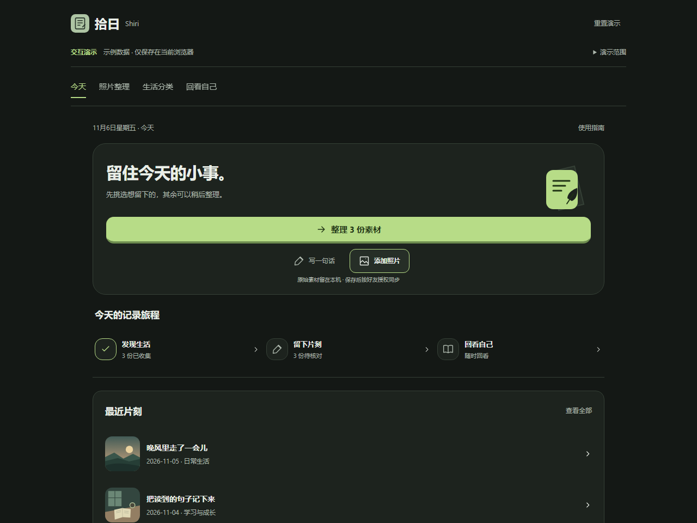
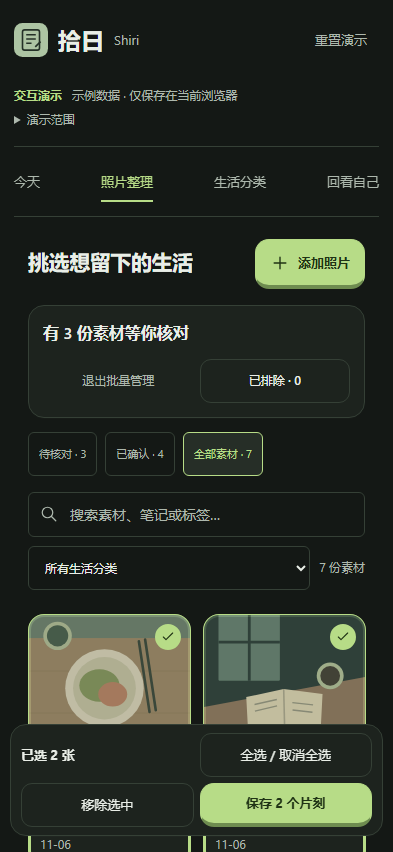
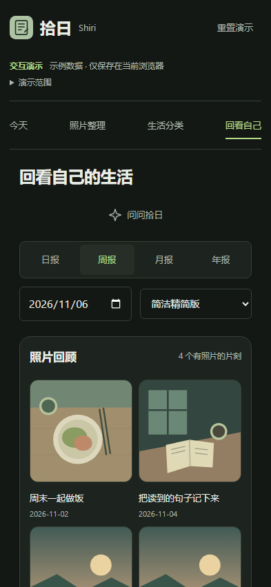

<h1 align="center">拾日 · Shiri</h1>

记录生活，认识自己，让重要的人自然了解彼此。

<a href="README.en.md">English</a> · <a href="#三分钟体验">快速体验</a> · <a href="docs/SETUP.md">开发与部署</a> · <a href="CONTRIBUTING.md">参与贡献</a>

把相册里零散的日常，变成可以回看的生活。

拾日是一款早期内测的生活记录 APP。先为自己留住照片、文字和感受，再通过日历与复盘认识自己的生活节奏。亲密好友可以在你明确授权的范围内了解近况。

## 从一张照片开始

- **整理**　Android 在授权范围内发现照片，批量审核、排除或保存，支持撤销排除。
- **留下**　保存片刻即进入个人档案，符合好友授权条件的片刻自动同步，无需再次发布。
- **回看**　生活日历、每日心情、照片回顾与日周月年规则复盘。
- **靠近**　好友主页按日期展示有权查看的片刻，照片经过服务端权限检查。

| 挑选想留下的 | 回看真实生活 |
|---|---|
|  |  |

[观看实际浏览器操作录屏](docs/images/demo.webm) · 截图与录屏均为独立演示的合成数据及原创示意图片。

## 三分钟体验

安装 Node.js 24 LTS 和 Git。下载源码并在包含 package.json 的目录打开终端。

~~~bash
npm ci --ignore-scripts --no-audit --no-fund
npm run demo
~~~

打开终端显示的本机地址，默认 http://127.0.0.1:4188/ 。

演示复用真实总览、审核、分类、日历与规则复盘组件。试试批量排除、撤销、保存片刻和导出 Markdown。数据使用独立的浏览器存储键，可随时重置。

演示无需账号、模型下载或云服务。完整 APP 的系统相册、邮箱认证、好友、上传与 AI 需要配置你自己的环境。[演示部署说明](docs/DEMO.md)

## Android 与平台状态

当前源码版本 **0.8.3-release / versionCode 29**，正式包名 cn.shiri.life。开发包 cn.shiri.life.debug，单独安装以保护已有用户数据。

| 平台 | 当前状态 |
|---|---|
| Android | 已有可构建工程，真实用户内测中；新机型和权限场景仍需真机验证 |
| Web 演示 | 本地整理、保存与规则复盘，可静态部署 |
| iOS | Capacitor 工程源码已准备，尚未在 Xcode 编译或真机验收 |
| HarmonyOS NEXT | 技术评估阶段，尚无原生 HAP |

APK 请从本仓库发布者实际上传的 **Releases** 获取；当前文档不代表 Release 已上线。自行构建的调试包不具备官方发布签名，不能覆盖正式包。[构建说明](docs/SETUP.md)

## 数据会去哪里

未审核素材、本地私人日记、每日心情、个人复盘默认保存在设备。保存并选择好友可见的片刻，在满足授权条件后会同步记录摘要和处理后的图片至 CloudBase 私有存储。

好友访问由服务端认证、RLS 与授权范围共同限制。撤销授权后，后续服务端请求应被拒绝；对方已经看到、截图或保存过的内容无法远程收回。

「问问拾日」仅在服务已配置、用户同意并主动选择摘要后按需请求模型。模型密钥留在服务端。公开源码默认云配置为空，演示禁止外部连接。正式 APP 使用前应备份本地数据，并阅读运营者提供的隐私说明。[安全边界](SECURITY.md)

## 工程结构

~~~text
life-app.mjs / life.css     页面与交互协调
src/                       记录、IndexedDB、备份、认证、同步与规则
android-shell/             Capacitor 8.5.3、Android Java、iOS 源码
cloudbase/                 认证配置示例、云函数、PostgreSQL 迁移/RLS/RPC
demo/                      隔离的交互演示与合成素材
tests/ / scripts/          单元测试、浏览器验证、构建工具
website/                   独立官网基线
~~~

使用 HTML、CSS、JavaScript ES Modules，Android 通过 Capacitor + WebView 复用业务页面。可将后端部署到自己的 CloudBase 账号。social-server/ 为历史本地测试服务，现有测试仍依赖它。

## 开发与验证

~~~bash
npm run check:source
npm run check:public
npm test
npx playwright install chromium
npm run test:browser:demo
npm run build:demo
~~~

完整 APP 需要 Android 依赖、本地模型和独立云环境。按 [SETUP](docs/SETUP.md) 操作；不要对真实用户环境重跑迁移。运行结果与限制见 [公开候选版验证](docs/PUBLIC_VERIFICATION.md)。

## 可以一起做的事

欢迎用脱敏复现步骤提交 Bug，或从小屏适配、可访问性、文档和规则复盘测试开始贡献。较大功能先通过 Issue 对齐范围。每个 PR 请说明测试和隐私影响。[贡献指南](CONTRIBUTING.md) · [团队协作](TEAM_GUIDE.md)

下一步优先验证跨机型可靠性、备份恢复、权限撤销与低成本复盘质量。语音、跨平台完整版本和商业化仍处于评估阶段。

## 许可与致谢

项目原创代码采用 [MIT](LICENSE)，第三方软件和模型遵循各自许可。[第三方说明](THIRD_PARTY_NOTICES.md)

感谢拾日的内测用户和团队贡献者。本公开快照从团队 0.8.3 源码整理，旧私有开发历史保留在团队仓库。希望这个持续打磨的小作品，能帮助你更轻松地留住日常。
