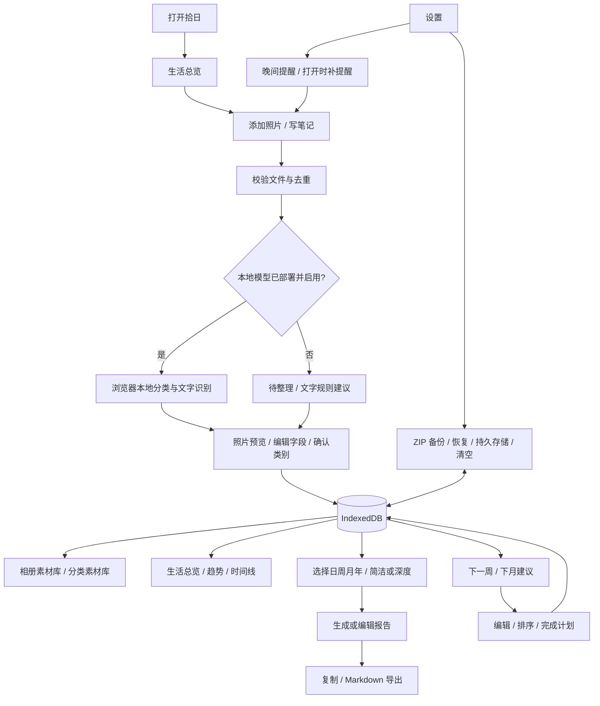

当前公开快照的安装、数据边界和验证状态以 [README](../README.md)、[SETUP](SETUP.md) 和 [PUBLIC_VERIFICATION](PUBLIC_VERIFICATION.md) 为准。以下包含历史阶段设计与记录，不能据此推断你的环境已部署。

# 拾日 · 个人生活自动复盘日志系统

## 1. 产品架构与方案选择

用户在晚间、低照度环境中，用手机选几张照片，补一句感受，回顾完整生活。界面以深石墨色为底、鼠尾草绿为操作色。健身和学习、出行、消费、心情、日常并列，不设置健身优先的首页。

三种路径：纯本地网页（本次采用；轻便、隐私边界清晰；相册必须主动选择）；原生应用（可申请相册枚举权限，但后台执行仍受系统调度）；云端应用（同步容易，但不符合默认全部本地的要求）。本次交付原生 HTML/CSS/ES modules、IndexedDB 和离线应用缓存，无账户、无遥测、无第三方字体与图片请求。

### 模块边界

| 模块 | 职责 | 输入 → 输出 |
|---|---|---|
| 采集 | 多选图片、拖放、检查文件、按内容去重、手动补录 | 用户授权的文件 → 原图 Blob、缩略图、记录 |
| 识别 | 可选的本地 CLIP 分类与 OCR；无模型时明确待整理 | 图片 → 分类候选、原始 OCR 文本、待核对的字段 |
| 整理 | 人工编辑、标签、自定义分类、心情与数值 | 草稿 → 确认记录；分类纠正 → 本地学习样本 |
| 分析 | 日期边界、分类频率、记录时长、心情与习惯趋势 | 确认记录 → 本地统计 |
| 复盘 | 日/周/月/年报告、简洁/深度两种规则模板 | 记录 → 可编辑 Markdown 报告 |
| 规划 | 基于最近周期的分类、习惯和遗憾建议 | 历史 → 可编辑/完成/拖动/按钮排序的计划 |
| 存储 | 事务、备份恢复、清空、持久化请求 | IndexedDB；ZIP 中 JSON + 原图 + 缩略图 |

### 能力边界（界面亦明确告知）

- 浏览器不能在 22:00 自行唤起相册、枚举手机今日新增照片，文件选择器要求用户操作。本版本按本地时区在页面可见时提醒；重新打开后补提醒；不保证锁屏/后台准时执行。
- 导入日期默认是当前选择日期，可修改；文件修改时间仅作参考，不冒充拍摄时间。支持筛选“文件修改于今天”，但不称为自动识别今日拍摄。
- 没有部署模型时，图片保留为“待整理”；基于文字的分类规则会标明规则来源，绝不宣称完成视觉识别。
- 本地模型提供候选分类，OCR 提供候选文字。地点、情绪、事件需人工确认，不从人物外观猜测健康或情绪，不虚构消费额。
- 人工修正累积在本地学习样本中，用已有的语义/关键词匹配改善建议，不宣称实时训练基础模型权重。
- 报告与规划默认用可解释的本地规则生成，深度模式增加结构化反思提示，不冒充大语言模型的理解。

## 2. 页面流程图

## 3. 文字版界面原型

### 桌面全局布局

左栏宽 224px：品牌「拾日 SHIRI」、生活总览、相册素材、生活分类、复盘报告、未来规划；底部为设置与隐私、本地存储说明。右侧内容最大宽 1400px。顶部：面包屑、当前日期、本地模式。手机改为顶部品牌 + 底部五项主导航，设置从顶部齿轮进入。键盘焦点可见，触控区域至少 44px。

### 生活总览

第一行：问候 + “把日子，慢慢拾起来。”、添加照片、写笔记。
第二行：日期选择、前一天/后一天/回到今天；本周七天导航。
第三行：四个真实指标（照片、生活记录、涵盖分类、已记录心情），没有记录时显示 0 或“未记录”。
主栏：当日生活时间线；空状态引导第一条笔记；右栏：晚间收集提醒、分类占比、7 日记录趋势。底部：最近照片与报告入口。首屏不虚构训练、卡路里或心理评分。

### 相册素材库

页面说明与导入按钮 → 搜索框、类别/状态筛选 → 照片网格（照片日期、类别、待核对状态）或文字便笺 → 点击详情弹层。详情包括原图预览、标题、日期时间、类别、标签、地点、说明、心情、时长、金额、体重、亮点/遗憾，保存和删除。选择分类并保存后作为人工确认。

### 生活分类

分类及数量横向清单 → 当前分类素材 → 新建分类输入。默认：日常、出行见闻、学习工作、消费、身心、健身、其他。健身可查看训练分钟与体重记录，其余报告正文仍围绕完整生活。

### 复盘报告

日/周/月/年切换 → 基准日期 → 简洁/深度 → 自动草稿与保存版本提示 → 可编辑 Markdown 预览与文本编辑 → 保存、重新生成（覆盖需确认）、复制、下载 Markdown。日报含事件、心情、亮点/遗憾；周报含频率/已记录时长；月报含前期对比；年报含月度时间线；健身为末尾独立小节。统计只计算记录数据，不将照片数当作真实时间分配。

### 未来规划

下一周/下月 → 生成建议（追加且去重） → 计划列表：完成框、类别、标题、依据、日期、编辑/删除、拖动手柄、上移/下移。手机使用按钮排序作为可靠触控方案；空数据时仅生成“补充记录”的起步建议，不编造历史。

### 设置与隐私

定时提醒开关 + 22:00 时间 + 浏览器限制说明；可选桌面通知；报告风格与自动保存草稿；本地模型启用/检测；数据库容量与持久化；完整备份/恢复；清空双重确认。恢复采取追加合并（同 ID 保留本机记录），格式/引用校验全部通过后单事务写入。

## 4. 状态与验收

加载、空数据、导入中、模型未部署、低置信度、存储失败、非法备份、容量不足均提供中文反馈。清空不触及其他网站及旧版健身日志；编辑未保存时导航/关闭需确认。导入完成后立即保存并更新视图；刷新保留所有字段。截图、文本均作为不可信输入安全渲染。报告中明确证据范围，心情只来自用户记录。

验收覆盖：创建/编辑/删除/标签筛选、图片去重和本地 Blob、所有周期边界、报告保存/复制/导出、计划持久化与排序、ZIP 往返、无外部请求、手机无横向溢出、旧版入口保留。
## 0.3.0 产品主线调整

本人日常生活节奏 → 新照片采集 → 可选私人自动上传 → 逐张核对日志 → 每日复盘。好友作为辅助页：只有本人逐张确认开放且授予对方权限，才可查看压缩照片及记录。授权“全部开放”不绕过逐张确认。

首页：今日待核对数量、已确认记录数、时间线、生活切面、记录习惯趋势与复盘入口。设置：晚间采集授权、私人上传单独开关、本地识别与备份。素材编辑：保存用于自己的复盘；另设逐张开放/收回按钮。后台数量小结与前台语义识别明确分开。
